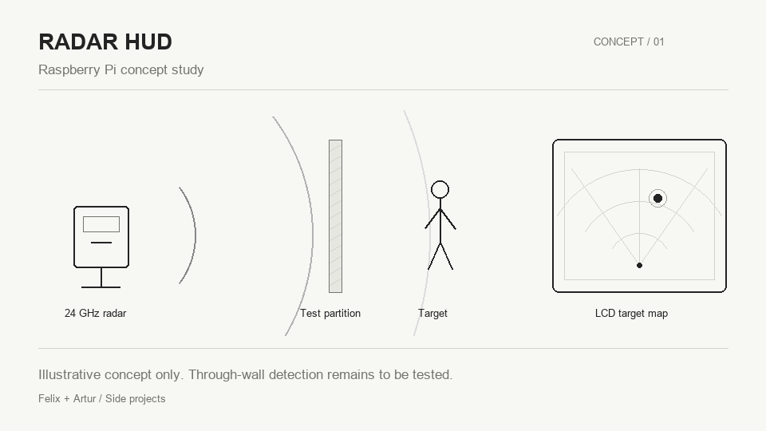
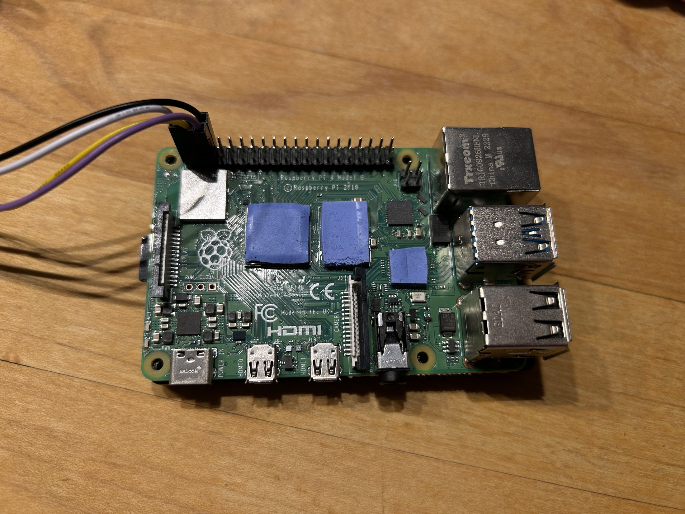
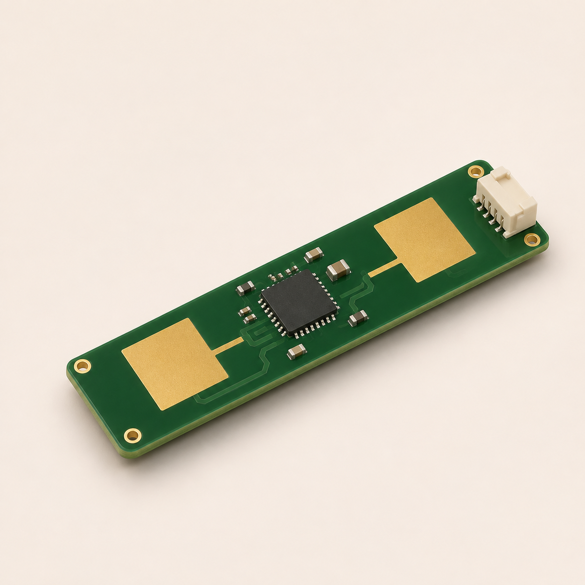
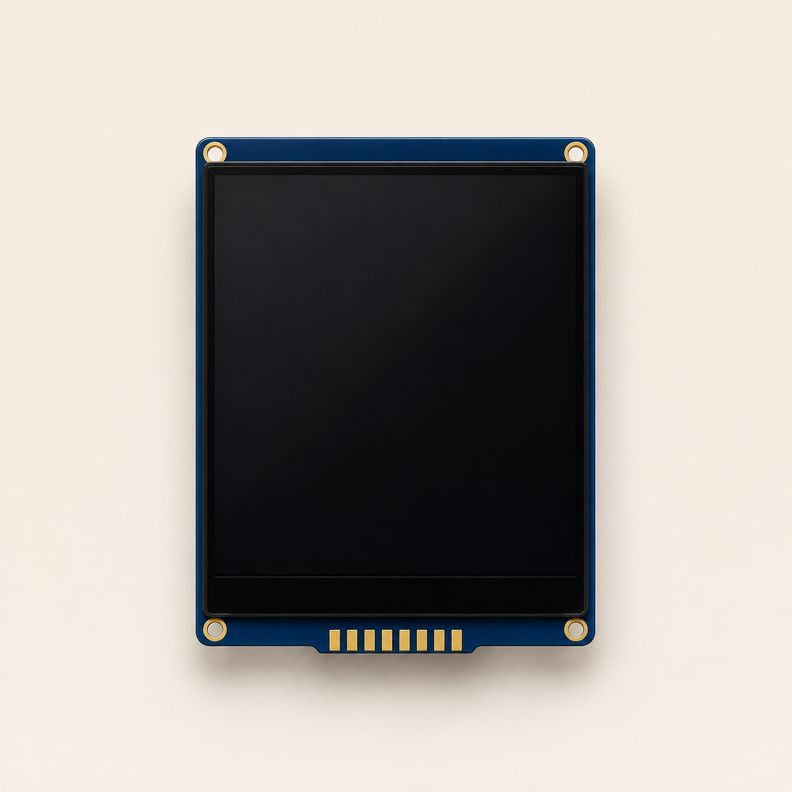

# Radar HUD

A Raspberry Pi radar display project by Felix and Artur. This repository
documents the concept, proposed hardware and tests we plan to run.

## Idea

We want to connect a radar sensor to our Raspberry Pi 4B and show detected
targets on a small LCD: a simple top-down view with dots for people moving
in front of the sensor. The visual idea comes from a handheld radar HUD.

Our first experiment will use an unobstructed room. Later, we want to test
whether useful detections remain possible behind a thin, non-metallic
partition.

Heartbeat and breathing detection are longer-term research ideas. The
currently proposed RD-03D is a motion and position tracking module.

## Concept sketch

## Planned setup

The radar performs its own signal processing. The Pi will read the reported
targets and draw the display. Direct Pi UART is a possible later alternative
to the USB adapter. The sensor stays fixed during the first tests; we do not
need the camera mount or servo controller from our previous project.

## Parts list

The four proposed additions come from our last shopping discussion on
23 October 2026. Their purchase and exact model versions are not confirmed.

| Part | Qty. | Purpose | Status |
| --- | --- | --- | --- |
| Raspberry Pi 4B | 1 | Read sensor data and draw the HUD | Already available from the face-tracker project |
| Pi power supply and microSD | 1 each | Run the Pi | Reuse existing equipment; check availability |
| [Ai-Thinker RD-03D](https://www.tinytronics.nl/en/sensors/motion/ai-thinker-rd-03d-24ghz-radar-sensor-module) | 1 | 24 GHz motion and position radar | Planned |
| [CH340E USB-UART adapter](https://www.tinytronics.nl/en/communication-and-signals/serial/usb/ch340e-ttl-usb-to-serial-converter-3.3-5v) | 1 | Connect the radar to a laptop or Pi | Planned |
| [4-pin PicoBlade-to-DuPont cable](https://www.tinytronics.nl/en/cables-and-connectors/cables-and-adapters/molex-compatible/molex-picoblade-female-to-dupont-female-compatible-cable-4p-15cm) | 1 | Radar connection | Planned; verify connector against the actual board |
| [Waveshare 2-inch IPS LCD](https://www.waveshare.com/product/2inch-lcd-module.htm) | 1 | Local display, 240 × 320 pixels, SPI | Planned; non-touch version |
| USB cable and any extra jumper leads | As needed | Power and connections | Check supplied cables first |

The RD-03D documentation specifies 5 V power and 3.3 V I/O. We will check
the adapter settings, connector pin order and actual board revision before
wiring. The LCD uses an ST7789-family controller.

## Hardware references

Our existing Raspberry Pi, photographed for the face-tracker project.

The two module images are AI-generated illustrations of the planned component
types. Check the manufacturer documentation for wiring, dimensions and board
revisions. See [image credits](docs/image-credits.md).

## First experiments

1. Confirm the parts, board revisions and connections.
2. Read radar targets over USB-UART on a laptop.
3. Repeat on the Pi and draw a simple target map on the LCD.
4. Record detections and dropouts with one person at known positions.
5. Compare an open-room baseline with a thin partition, keeping the sensor fixed.

We will record distance, wall material and thickness, movement, and false
detections.

No application software or experimental results have been added yet.
See the [planning notes](docs/planning-notes.md) for the options we considered.

## References

- [Ai-Thinker RD-03D specification](https://en.ai-thinker.com/Uploads/file/20231016/20231016032622_13559.pdf)
- [Waveshare LCD documentation](https://www.waveshare.com/wiki/2inch_LCD_Module)
- [Our Raspberry Pi face tracker](https://github.com/Felix-Artur-Sideprojects/raspberry-pi-face-tracker)

Built by [Felix](https://github.com/Felix561) and [Artur](https://github.com/Artur-04)
in [Side projects](https://github.com/Felix-Artur-Sideprojects).
